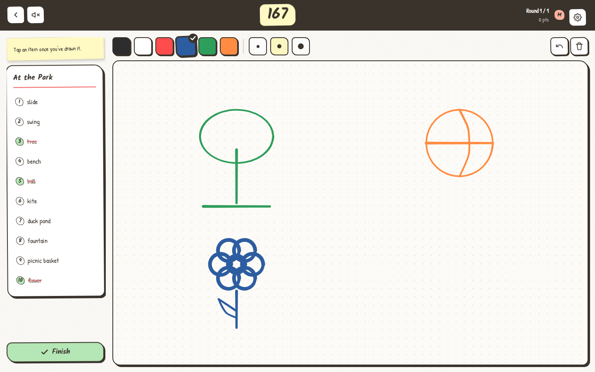
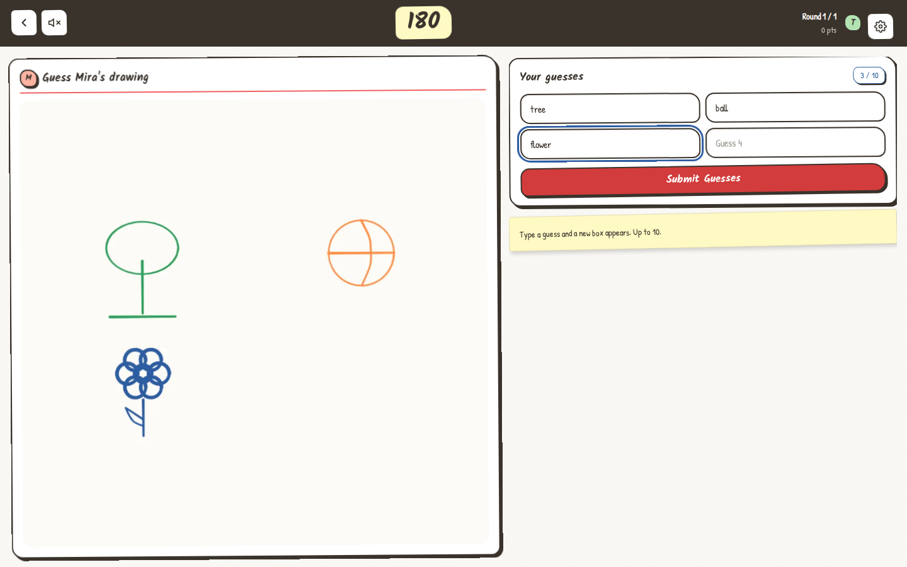

# 6 Second Scribbles

[](https://github.com/simonvanlierde/6-second-scribbles/actions/workflows/ci.yml)
[](https://codecov.io/gh/simonvanlierde/6-second-scribbles)
[](https://app.codspeed.io/simonvanlierde/6-second-scribbles?utm_source=badge)
[](https://6ss.duinlab.nl)
[](LICENSE)

6 Second Scribbles is a real-time multiplayer drawing and guessing game. Everyone races through their own list of prompts, then each player guesses another player's drawings.

Play it live at [6ss.duinlab.nl](https://6ss.duinlab.nl). The layout is built for desktop for now. It's a Svelte 5 frontend and a FastAPI backend, kept in sync by committed, generated contracts.

| The drawer's view | What the guessers see |
| --- | --- |
|  |  |

## Running locally

You need Node 26+, Python 3.14+, `pnpm`, `uv`, `just`, and Docker.

```bash
just install                                   # install dependencies
cp backend/.env.example backend/.env.dev
cp frontend/.env.example frontend/.env.local
just dev                                        # Docker services + dev servers
```

Then open <http://localhost:3001>. `just up` runs the whole stack in containers instead. `just test`, `just check`, and `just format` run the tests, the linters, and the formatters.

## Development

Run the checks and tests that need no Docker. CI runs these blocks in a fresh container.

```sh
just install
just check-frontend check-backend
just test
```

## Social card

`frontend/public/og.png` is the 1200x630 card shown when the link is shared. It is made with the generator in
[my site repo](https://github.com/simonvanlierde/simonvanlierde.github.io/tree/main/scripts/social-card)
(needs Docker). From a checkout of that repo, with this repo next to it:

```sh
pnpm gen:card --visual ../6-second-scribbles/docs/screenshots/desktop-drawing.png --name "Six Second Scribbles" \
  --line "A real-time multiplayer drawing and guessing game." \
  --domain 6ss.duinlab.nl --focus "32% 50%" --out ../6-second-scribbles/frontend/public/og.png
```

## Docs

- [Product brief](frontend/PRODUCT.md) and the [next roadmap](frontend/docs/roadmap.md)
- [Architecture](docs/architecture.md), including how production runs, and the [design decisions](docs/adr/)
- [Capacity](docs/capacity.md): how many rooms one backend holds
- [Frontend](frontend/README.md), [backend](backend/README.md), and [contracts](contracts/README.md)
- [Accessibility statement](frontend/docs/accessibility.md)
- [Contributing](CONTRIBUTING.md)

## Attribution

Inspired by *Six Second Scribbles* by Hazel Reynolds, published by [Gamely Games](https://gamelygames.com/products/six-second-scribbles), and the solo web version by [Oliver Culley de Lange](https://github.com/OliverCulleyDeLange/6ss).

## License

The code is under the [MIT License](LICENSE). The original *Six Second Scribbles* game concept, brand, and card content belong to their owners.
