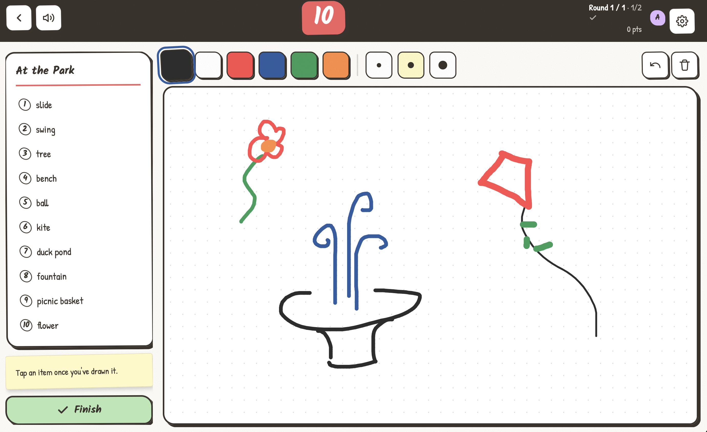
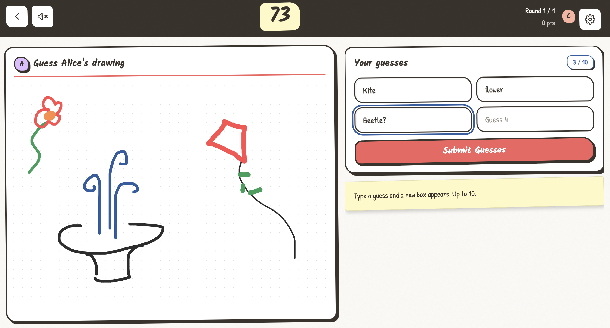

# 6 Second Scribbles

[](https://github.com/simonvanlierde/6-second-scribbles/actions/workflows/ci.yml)
[](https://codecov.io/gh/simonvanlierde/6-second-scribbles)
[](https://6ss.duinlab.nl)
[](LICENSE)

6 Second Scribbles is a multiplayer drawing and guessing game that runs in real time. One player races through a list of prompts while everyone else guesses what's being drawn.

Play the live demo at [6ss.duinlab.nl](https://6ss.duinlab.nl); the layout is desktop-first for now. It's a Vue 3 frontend and a FastAPI backend kept in sync by committed, generated contracts.

| The drawer's view | What the guessers see |
| --- | --- |
|  |  |

## Running locally

Requires Node 26+, Python 3.14+, `pnpm`, `uv`, `just`, and Docker.

```bash
just install                                   # install dependencies
cp backend/.env.example backend/.env.dev
cp frontend/.env.example frontend/.env.local
just dev                                        # Docker services + dev servers
```

`just up` runs the whole stack in containers. `just test`, `just check`, and `just format` run the tests, the linters, and the formatters.

## Docs

- [Architecture](docs/architecture.md), with production deployment, and the [ADRs](docs/adr/)
- [Capacity](docs/capacity.md): how many rooms one backend holds
- [Frontend](frontend/README.md), [backend](backend/README.md), and [contracts](contracts/README.md)
- [Contributing](CONTRIBUTING.md)

## Attribution

Inspired by *Six Second Scribbles* by Hazel Reynolds, published by [Gamely Games](https://gamelygames.com/products/six-second-scribbles), and the solo web version by [Oliver Culley de Lange](https://github.com/OliverCulleyDeLange/6ss).

## License

Code is released under the [MIT License](LICENSE). The original *Six Second Scribbles* game concept, brand, and card content remain the property of their respective owners.
