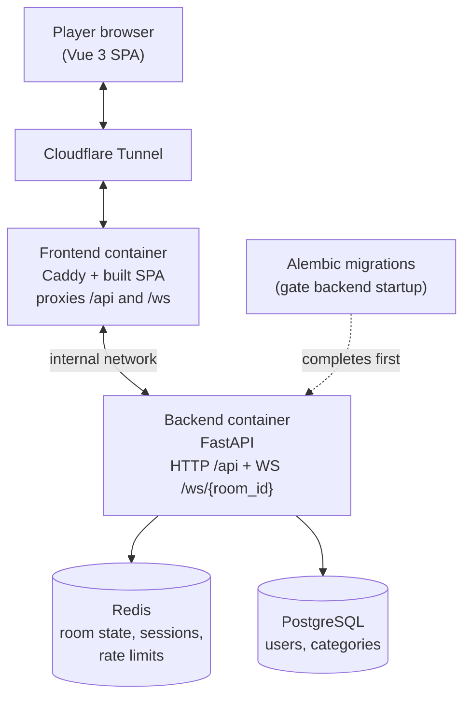
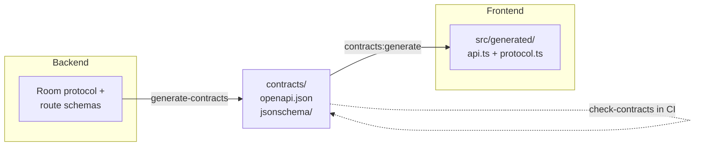
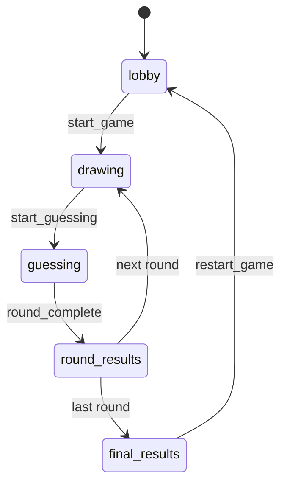

# Architecture

A Vue 3 single-page frontend, a FastAPI backend, and committed contracts that keep
the two in sync. The [frontend](../frontend/README.md) and
[backend](../backend/README.md) READMEs cover each side.

## Runtime topology

The live demo runs on my own server as the Compose stack in
[`compose.prod.yml`](../compose.prod.yml), started with `just up-prod`. The only
way in from outside is a Cloudflare Tunnel (`cloudflared`, in the Compose `tunnel`
profile). Caddy serves the built SPA and passes `/api` and `/ws` to the backend
over the internal Docker network. No port is open to the internet. The backend
starts only after the database migrations finish.

The comments in `compose.prod.yml` explain each resource limit, the loopback bind,
and the digest pin on `cloudflared`.

## Contract-first boundary

The backend owns the wire format and exports it into `contracts/`. The frontend
generates its types from those files, and CI fails if the backend no longer
reproduces them. [ADR 0001](adr/0001-committed-generated-contracts.md) has the
reasons and the alternatives.

## Game loop

A room is a small state machine. The backend drives it and pushes each change to
every client over WebSockets.

[`GamePhase`](../backend/app/core/types.py) defines the phases. The client and
server messages that drive the transitions are in
[`app/rooms/protocol.py`](../backend/app/rooms/protocol.py).
