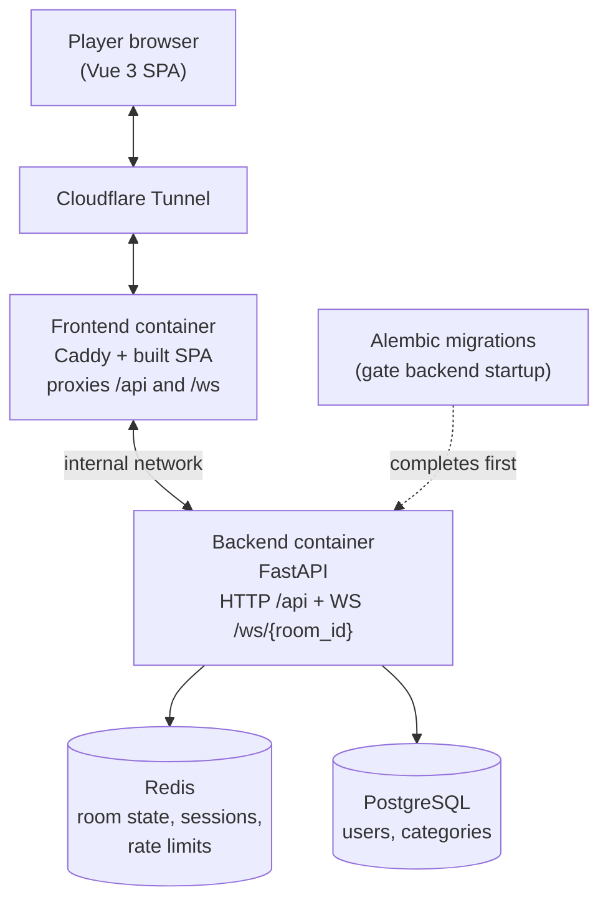
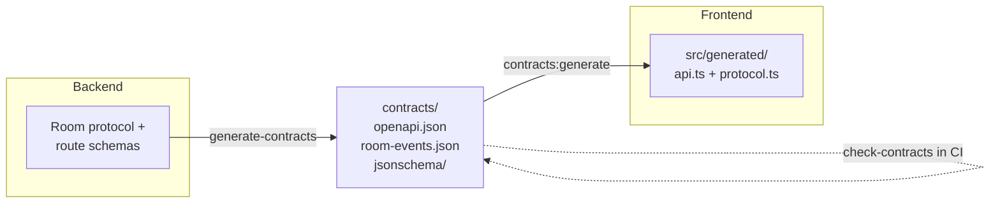
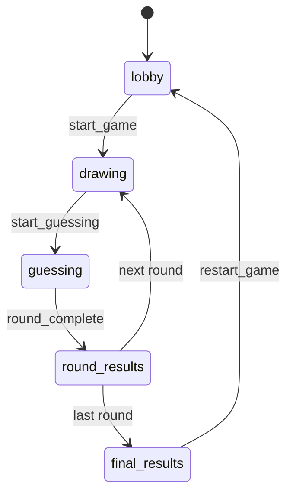

# Architecture

6 Second Scribbles keeps three parts in one repo: a Vue 3 single-page frontend, a
FastAPI backend, and a set of committed contracts that keep the two sides in sync.
This page is the overview. The [frontend](../frontend/README.md) and
[backend](../backend/README.md) READMEs cover each side in more detail.

## Runtime Topology

In production, the only way in from outside is a Cloudflare tunnel. Caddy serves
the built SPA and passes `/api` and `/ws` on to the backend over the internal
Docker network, so the backend is never published directly. Redis holds the
short-lived room and session state. PostgreSQL holds the content that must last:
users and category data. Database migrations run to completion before the backend
starts.

The overrides in [`compose.prod.yml`](../compose.prod.yml) pin the resource limits,
bind the frontend to loopback, and pin `cloudflared` by image digest. The comments
in that file give the reason for each one.

## Contract-First Boundary

The backend owns the wire format. Its route and schema definitions and the room
protocol are exported into `contracts/` as an OpenAPI document and JSON Schema
files. The frontend generates its TypeScript and Zod types from those committed
files, so it never guesses at the shape of a message. CI checks that the backend
still reproduces the committed contracts. If the two sides drift apart, the build
fails before the change reaches the running app.

[ADR 0001](adr/0001-committed-generated-contracts.md) records why we chose this
and what else we considered.

## Game Loop

A room is a small state machine. The backend drives it and pushes each change to
every client over WebSockets. Players move through the phases below. After the
last round the room lands on final results, and a restart returns it to the lobby.

[`GamePhase`](../backend/app/core/types.py) defines the phase values. The client
and server message types that drive the transitions live in
[`app/rooms/protocol.py`](../backend/app/rooms/protocol.py).
